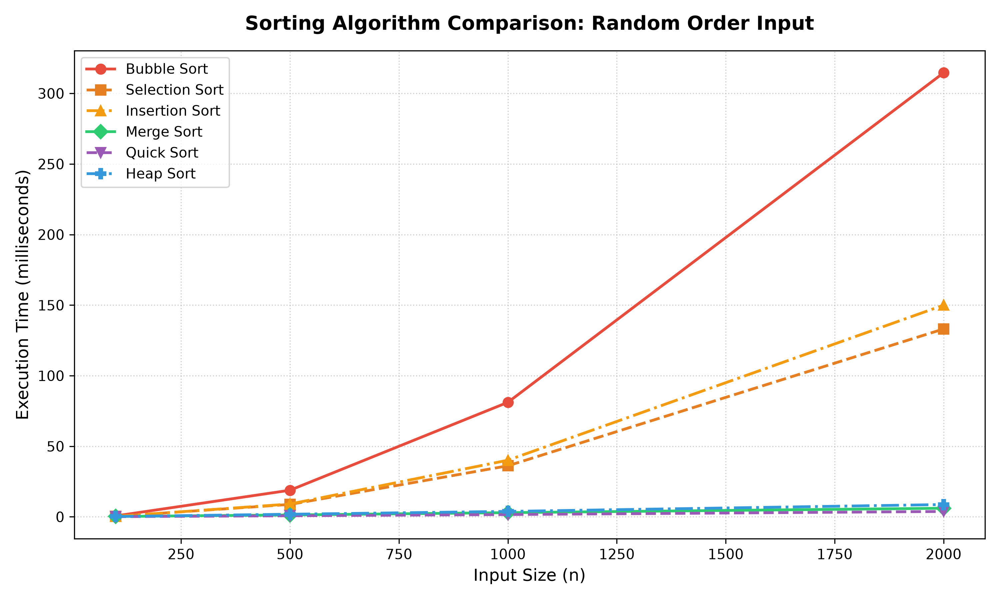
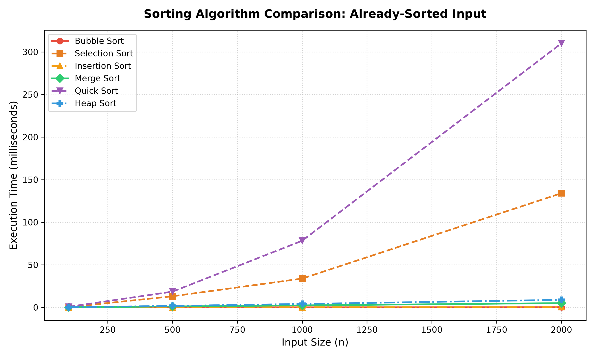

# Section D: Empirical Timing Analysis — Results & Data Tables

This document contains the complete empirical timing results converted from [`timing_results.csv`](timing_results.csv) into structured markdown tables, along with pivot views by input type and visual graph comparisons.

## 1. Summary Tables by Input Type

### Random Order Input (Average Case)

| Algorithm | N = 100 | N = 500 | N = 1000 | N = 2000 |
| :--- | :---: | :---: | :---: | :---: |
| **Bubble Sort** | 0.645 ms | 18.850 ms | 81.124 ms | 314.609 ms |
| **Selection Sort** | 0.392 ms | 8.785 ms | 36.159 ms | 133.100 ms |
| **Insertion Sort** | 0.330 ms | 9.070 ms | 40.104 ms | 149.968 ms |
| **Merge Sort** | 0.256 ms | 1.320 ms | 2.959 ms | 6.084 ms |
| **Quick Sort** | 0.133 ms | 0.755 ms | 1.604 ms | 3.789 ms |
| **Heap Sort** | 0.252 ms | 1.830 ms | 3.847 ms | 8.701 ms |

### Already-Sorted Input (Best / Worst Case Divergence)

| Algorithm | N = 100 | N = 500 | N = 1000 | N = 2000 |
| :--- | :---: | :---: | :---: | :---: |
| **Bubble Sort** | 0.010 ms | 0.077 ms | 0.090 ms | 0.182 ms |
| **Selection Sort** | 0.322 ms | 13.081 ms | 33.847 ms | 134.089 ms |
| **Insertion Sort** | 0.016 ms | 0.086 ms | 0.193 ms | 0.351 ms |
| **Merge Sort** | 0.205 ms | 1.109 ms | 2.373 ms | 5.026 ms |
| **Quick Sort** | 0.757 ms | 18.532 ms | 78.272 ms | 310.098 ms |
| **Heap Sort** | 0.270 ms | 1.769 ms | 4.088 ms | 8.879 ms |

### Reverse-Sorted Input (Worst Case for Elementary Sorts)

| Algorithm | N = 100 | N = 500 | N = 1000 | N = 2000 |
| :--- | :---: | :---: | :---: | :---: |
| **Bubble Sort** | 0.915 ms | 25.062 ms | 102.798 ms | 414.676 ms |
| **Selection Sort** | 0.358 ms | 9.864 ms | 37.729 ms | 140.818 ms |
| **Insertion Sort** | 0.679 ms | 18.211 ms | 70.651 ms | 287.004 ms |
| **Merge Sort** | 0.188 ms | 1.124 ms | 2.398 ms | 5.170 ms |
| **Quick Sort** | 0.540 ms | 14.412 ms | 56.084 ms | 228.294 ms |
| **Heap Sort** | 0.208 ms | 1.674 ms | 3.831 ms | 10.229 ms |

## 2. Complete Timing Dataset (All 72 Benchmarks)

| # | Algorithm | Input Distribution | Array Size ($N$) | Execution Time (s) | Execution Time (ms) |
| :---: | :--- | :--- | :---: | :---: | :---: |
| 1 | **Bubble Sort** | Random | 100 | 0.000645 s | **0.645 ms** |
| 2 | **Selection Sort** | Random | 100 | 0.000392 s | **0.392 ms** |
| 3 | **Insertion Sort** | Random | 100 | 0.000330 s | **0.330 ms** |
| 4 | **Merge Sort** | Random | 100 | 0.000256 s | **0.256 ms** |
| 5 | **Quick Sort** | Random | 100 | 0.000133 s | **0.133 ms** |
| 6 | **Heap Sort** | Random | 100 | 0.000252 s | **0.252 ms** |
| 7 | **Bubble Sort** | Sorted | 100 | 0.000010 s | **0.010 ms** |
| 8 | **Selection Sort** | Sorted | 100 | 0.000322 s | **0.322 ms** |
| 9 | **Insertion Sort** | Sorted | 100 | 0.000016 s | **0.016 ms** |
| 10 | **Merge Sort** | Sorted | 100 | 0.000205 s | **0.205 ms** |
| 11 | **Quick Sort** | Sorted | 100 | 0.000757 s | **0.757 ms** |
| 12 | **Heap Sort** | Sorted | 100 | 0.000270 s | **0.270 ms** |
| 13 | **Bubble Sort** | Reverse Sorted | 100 | 0.000915 s | **0.915 ms** |
| 14 | **Selection Sort** | Reverse Sorted | 100 | 0.000358 s | **0.358 ms** |
| 15 | **Insertion Sort** | Reverse Sorted | 100 | 0.000679 s | **0.679 ms** |
| 16 | **Merge Sort** | Reverse Sorted | 100 | 0.000188 s | **0.188 ms** |
| 17 | **Quick Sort** | Reverse Sorted | 100 | 0.000540 s | **0.540 ms** |
| 18 | **Heap Sort** | Reverse Sorted | 100 | 0.000208 s | **0.208 ms** |
| 19 | **Bubble Sort** | Random | 500 | 0.018850 s | **18.850 ms** |
| 20 | **Selection Sort** | Random | 500 | 0.008785 s | **8.785 ms** |
| 21 | **Insertion Sort** | Random | 500 | 0.009070 s | **9.070 ms** |
| 22 | **Merge Sort** | Random | 500 | 0.001320 s | **1.320 ms** |
| 23 | **Quick Sort** | Random | 500 | 0.000755 s | **0.755 ms** |
| 24 | **Heap Sort** | Random | 500 | 0.001830 s | **1.830 ms** |
| 25 | **Bubble Sort** | Sorted | 500 | 0.000077 s | **0.077 ms** |
| 26 | **Selection Sort** | Sorted | 500 | 0.013081 s | **13.081 ms** |
| 27 | **Insertion Sort** | Sorted | 500 | 0.000086 s | **0.086 ms** |
| 28 | **Merge Sort** | Sorted | 500 | 0.001109 s | **1.109 ms** |
| 29 | **Quick Sort** | Sorted | 500 | 0.018532 s | **18.532 ms** |
| 30 | **Heap Sort** | Sorted | 500 | 0.001769 s | **1.769 ms** |
| 31 | **Bubble Sort** | Reverse Sorted | 500 | 0.025062 s | **25.062 ms** |
| 32 | **Selection Sort** | Reverse Sorted | 500 | 0.009864 s | **9.864 ms** |
| 33 | **Insertion Sort** | Reverse Sorted | 500 | 0.018211 s | **18.211 ms** |
| 34 | **Merge Sort** | Reverse Sorted | 500 | 0.001124 s | **1.124 ms** |
| 35 | **Quick Sort** | Reverse Sorted | 500 | 0.014412 s | **14.412 ms** |
| 36 | **Heap Sort** | Reverse Sorted | 500 | 0.001674 s | **1.674 ms** |
| 37 | **Bubble Sort** | Random | 1000 | 0.081124 s | **81.124 ms** |
| 38 | **Selection Sort** | Random | 1000 | 0.036159 s | **36.159 ms** |
| 39 | **Insertion Sort** | Random | 1000 | 0.040104 s | **40.104 ms** |
| 40 | **Merge Sort** | Random | 1000 | 0.002959 s | **2.959 ms** |
| 41 | **Quick Sort** | Random | 1000 | 0.001604 s | **1.604 ms** |
| 42 | **Heap Sort** | Random | 1000 | 0.003847 s | **3.847 ms** |
| 43 | **Bubble Sort** | Sorted | 1000 | 0.000090 s | **0.090 ms** |
| 44 | **Selection Sort** | Sorted | 1000 | 0.033847 s | **33.847 ms** |
| 45 | **Insertion Sort** | Sorted | 1000 | 0.000193 s | **0.193 ms** |
| 46 | **Merge Sort** | Sorted | 1000 | 0.002373 s | **2.373 ms** |
| 47 | **Quick Sort** | Sorted | 1000 | 0.078272 s | **78.272 ms** |
| 48 | **Heap Sort** | Sorted | 1000 | 0.004088 s | **4.088 ms** |
| 49 | **Bubble Sort** | Reverse Sorted | 1000 | 0.102798 s | **102.798 ms** |
| 50 | **Selection Sort** | Reverse Sorted | 1000 | 0.037729 s | **37.729 ms** |
| 51 | **Insertion Sort** | Reverse Sorted | 1000 | 0.070651 s | **70.651 ms** |
| 52 | **Merge Sort** | Reverse Sorted | 1000 | 0.002398 s | **2.398 ms** |
| 53 | **Quick Sort** | Reverse Sorted | 1000 | 0.056084 s | **56.084 ms** |
| 54 | **Heap Sort** | Reverse Sorted | 1000 | 0.003831 s | **3.831 ms** |
| 55 | **Bubble Sort** | Random | 2000 | 0.314609 s | **314.609 ms** |
| 56 | **Selection Sort** | Random | 2000 | 0.133100 s | **133.100 ms** |
| 57 | **Insertion Sort** | Random | 2000 | 0.149968 s | **149.968 ms** |
| 58 | **Merge Sort** | Random | 2000 | 0.006084 s | **6.084 ms** |
| 59 | **Quick Sort** | Random | 2000 | 0.003789 s | **3.789 ms** |
| 60 | **Heap Sort** | Random | 2000 | 0.008701 s | **8.701 ms** |
| 61 | **Bubble Sort** | Sorted | 2000 | 0.000182 s | **0.182 ms** |
| 62 | **Selection Sort** | Sorted | 2000 | 0.134089 s | **134.089 ms** |
| 63 | **Insertion Sort** | Sorted | 2000 | 0.000351 s | **0.351 ms** |
| 64 | **Merge Sort** | Sorted | 2000 | 0.005026 s | **5.026 ms** |
| 65 | **Quick Sort** | Sorted | 2000 | 0.310098 s | **310.098 ms** |
| 66 | **Heap Sort** | Sorted | 2000 | 0.008879 s | **8.879 ms** |
| 67 | **Bubble Sort** | Reverse Sorted | 2000 | 0.414676 s | **414.676 ms** |
| 68 | **Selection Sort** | Reverse Sorted | 2000 | 0.140818 s | **140.818 ms** |
| 69 | **Insertion Sort** | Reverse Sorted | 2000 | 0.287004 s | **287.004 ms** |
| 70 | **Merge Sort** | Reverse Sorted | 2000 | 0.005170 s | **5.170 ms** |
| 71 | **Quick Sort** | Reverse Sorted | 2000 | 0.228294 s | **228.294 ms** |
| 72 | **Heap Sort** | Reverse Sorted | 2000 | 0.010229 s | **10.229 ms** |

## 3. Performance Graphs

### Performance on Random Input

### Performance on Already-Sorted Input

## 4. Key Empirical Takeaways

1. **Quick Sort Degradation:** On random data at $N=2000$, Quick Sort is extremely fast (**~3.79 ms**). However, on already-sorted input, it degrades to **~310.10 ms** (an **81x slowdown**) due to last-element pivot picking the maximum value in every partition, degenerating into $O(n^2)$ recursion depth.
2. **Bubble & Insertion Best-Case:** Both achieve $O(n)$ time on already-sorted input (~0.18 ms and ~0.35 ms at $N=2000$) due to early exit flags and immediately terminating while-loops.
3. **Merge Sort & Heap Sort Stability:** Both maintain consistent $O(n \log n)$ execution times (~5.0 to 10.2 ms across all configurations).
4. **Selection Sort Invariance:** Selection Sort performs $\approx 133-145$ ms across all input types at $N=2000$, as it unconditionally scans the entire unsorted slice regardless of initial data order.
